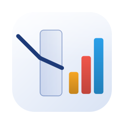

<p align="center">
  <picture>
    <source media="(prefers-color-scheme: dark)" srcset="docs/images/icon-dark.png">
    
  </picture>
</p>

<h1 align="center">Refract</h1>

<p align="center">Graphs and statistics for scientists, in a free desktop app that opens and saves <code>.prism</code> and <code>.pzfx</code> project files.</p>

Refract lets you keep working on projects that colleagues made in GraphPad Prism, and hand them back. It reads the data tables, analyses, graphs and layouts of a project, lets you edit them, and saves a file that Prism opens as its own.

> Refract is an independent project. It is not affiliated with, endorsed by or sponsored by GraphPad Software, LLC or Dotmatics. GraphPad and Prism are trademarks of GraphPad Software, LLC; they are used here only to say which files Refract can open and save.

## What it does

- **Data tables:** XY, column, grouped, contingency, survival, parts of whole, nested and multiple variables, with replicates, entered mean/SD/SEM and excluded values.
- **Graphs:** 100 graph types across the eight table kinds, edited on the canvas: select any element (a bar, a data set, a text, a significance bracket) to move, resize or format it; right-click menus; colour schemes; fill patterns; drawn lines, arrows, brackets and shapes. Export to PNG, PDF and SVG.
- **Analyses (49 in the New Analysis dialog):** descriptive statistics, normality and outlier tests, t tests and their nonparametric versions, one-, two- and three-way ANOVA with multiple comparisons, nested tests, correlation, linear, nonlinear (curve fitting), Deming and logistic regression, standard curves, survival curves, ROC and Bland-Altman, contingency tests, multiple regression, Cox regression, PCA, hierarchical and k-means clustering, splines and smoothing, and data transforms.
- **Checked against Prism:** every analysis is compared value for value with Prism 11.1 on generated data sets; the few known differences (for example random simulations) are listed in [docs/format/findings.md](docs/format/findings.md).
- **Light and dark:** the app and its icon follow the system theme.

## Compared with Prism

Refract covers the everyday work of a Prism project: entering data, the common analyses and graphs, editing them, and exchanging files. It does not try to be a copy of Prism, and some of Prism's features are not there yet.

| | GraphPad Prism 11 | Refract |
|---|---|---|
| Price and license | Commercial, subscription | Free, GPL-3.0 open source |
| Platforms | macOS, Windows | macOS (Apple silicon); Windows planned |
| Data table kinds | 8 | The same 8 |
| Graph types | Many, with more variants per type | 100, 72 of them saved as Prism's own graph type |
| Analyses | The full menu, including simulations | 49 in the dialog (no Simulate data or Generate curve) |
| Graph editing | Full | Select, move, resize and format any element; colour schemes; drawn objects |
| Layouts | Yes | Yes (Letter or A4 pages) |
| Opens `.prism` / `.pzfx` | Yes / Yes | Yes / Yes |
| Saves `.prism` / `.pzfx` | Yes / Yes | Yes / data-table edits only |
| Scripting | Prism scripts | Command line (`python -m refract`) |

## Compatibility with Prism files

- **Opening:** Refract reads the data tables, info sheets, analyses (with their stored results), graphs and layouts of `.prism` files from Prism 10 and 11, and `.pzfx` files. Graphs from a Prism file are drawn by Refract from their stored formatting.
- **Saving `.prism`:** files Refract saves open in Prism as ordinary projects. Analyses are written with Prism's own parameters, so Prism recalculates them itself when it opens the file. Formatting you change on a graph that came from Prism is written back into it where that is supported.
- **Graphs made in Refract:** 72 of the 100 graph types are saved as Prism's own graph type, so colleagues can open and edit them in Prism. Drawn side by side with Prism's rendering of the same file, the marks overlap with a median score of 0.988, where 1 means identical. By family: XY 0.998, column 0.997, survival 0.998, parts of whole 1.000, grouped 0.95, contingency 0.94, nested 0.84. The other 28 types have no Prism equivalent or are not mapped yet; they are kept in the file for Refract, and Prism keeps them when it re-saves but does not show them. **File ▸ Prism Compatibility Report** lists everything Prism will show differently before you send a file.
- **`.pzfx` files:** Refract saves changes to their data tables (values, excluded values, titles, added data sets) back into the file and leaves Prism's graphs, analyses and layouts untouched, so Prism redraws and recalculates them. Anything else made in Refract needs Save As `.prism`.
- **Statistics:** each analysis is checked value for value against Prism 11.1 on generated data sets, and against the results Prism stored in its own sample files. The known differences are where Prism uses random numbers (K-means starting points, the gap statistic, parallel analysis in PCA) and one cluster index (Krzanowski-Lai). [docs/format/findings.md](docs/format/findings.md) lists what was verified and how.
- **What Refract never does:** it does not change which app opens `.prism` and `.pzfx` files, and it does not read, modify or depend on a Prism installation.

## Install

**macOS** (Apple silicon, macOS 14.4 or later): download `Refract-<version>-macos-arm64.dmg` from the [Releases](../../releases) page, open it and drag Refract to Applications. The app is not signed with a Developer ID yet, so the first time, right-click Refract ▸ **Open**, then **Open** again.

**Windows:** planned; the installer script exists but has not been built or tested yet.

Refract appears in Finder's **Open With** list for `.prism` and `.pzfx` files; it never makes itself their default app. To check an installation, run `/Applications/Refract.app/Contents/MacOS/Refract selftest`.

## Use

The user guide is in the app under **Help ▸ Refract User Guide** ([source](refract/ui/guide.md)). There is also a command line:

```bash
python -m refract inspect FILE        # tables, analyses, graphs
python -m refract export FILE OUTDIR  # every data table as CSV
python -m refract anonymize FILE OUT  # clear account names and personal fields
python -m refract gui [FILE]          # the desktop app
```

## Develop

Requires Python 3.12.

```bash
uv venv --python 3.12 .venv
uv pip install --python .venv/bin/python -e ".[dev]"
QT_QPA_PLATFORM=offscreen .venv/bin/python -m pytest -q
```

How the file format works, and what was verified and how, is in [docs/format/findings.md](docs/format/findings.md).

## Build packages

- **macOS:** `tools/packaging/build_macos.sh` makes `dist/Refract-<version>-macos-<arch>.dmg` (ad-hoc signed; set `REFRACT_SIGN_ID` to sign and `REFRACT_NOTARY_PROFILE` to notarize). With Xcode installed it also builds the light and dark app icon.
- **Windows (untested):** `tools\packaging\build_windows.ps1`, with Inno Setup 6.
- The GitHub Actions workflow `.github/workflows/package.yml` builds the macOS package and runs its self-test.

## License

Copyright © 2026 the Refract authors. Refract is free software: you can redistribute it and/or modify it under the terms of the GNU General Public License as published by the Free Software Foundation, either version 3 of the License, or (at your option) any later version. See [LICENSE](LICENSE). The packages also carry the licenses of the components they bundle (Qt and PySide6: LGPL-3.0; NumPy, SciPy: BSD-3-Clause; Python: PSF) in `LICENSES/`.
